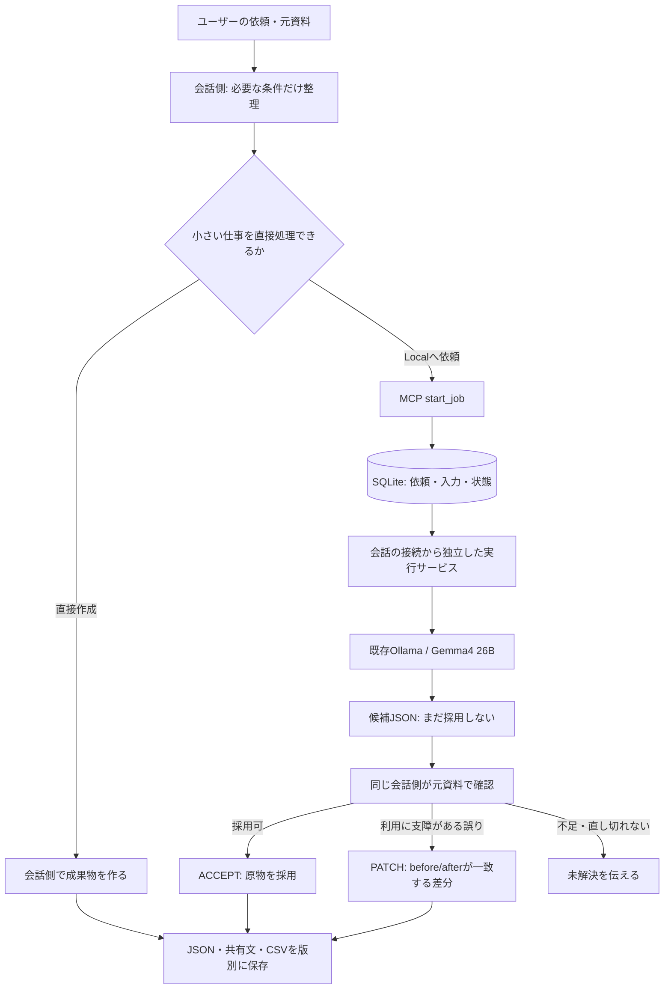

# Orchestrator Localの構成

独立したCloud ReviewerやLuna/Terraへの引継ぎを追加しない。会話側のモデルは利用者がアプリで選んだモデルなので、プログラムがSolやeffortを固定するものではない。

`core.py`が入力制限・JSON/schema検証・差分・保存、`server.py`がMCPの8ツール、`service.py`が一重起動とジョブ実行、`worker.py`がOllama接続と中止を担当する。Local候補にshell・ファイル操作・tool実行権限は渡さない。

元依頼と入力は固定して保存する。同じrequest_keyと入力の再送は同じジョブを返す。候補と保存結果はhashで識別し、古いhashや一致しないbefore、重複・親子の差分、出力形式違反を採用しない。追加修正は新しいresult版へ保存する。

実行サービスはMCP stdio processの子として起動しない。Windowsのクライアントがstdioの子processを終了しても作業を継続できるように、別起動とする。OS再起動などで実行が中断した場合はINTERRUPTEDとし、自動再生成しない。ログイン自動起動は利用者が選んだ場合だけ登録する。

JSON/schemaやCSV列の検証は形式確認であり、業務上の正しさの判定は会話側に残る。会話側の最終確認も誤り得る。研究用100件の結果や、別に公開したRust開発用のRouter/Workerを、そのままこの業務アプリの保証とは扱わない。

## GUIと配布版

`gui.py`は初回設定・ホーム・作業履歴の画面を提供し、時間のかかる処理は別スレッドで行う。`desktop.py`が`installation.py`の設定/接続登録、既存サービスの一重起動、同じStoreの履歴/中止/成果物を利用する。画面の開閉や状態確認では生成せず、候補をGUIから自動採用しない。

Windows配布版はPython同梱のフォルダ形式。`OrchestratorLocal.exe`は画面と非表示サービス、`OrchestratorLocal.Runtime.exe`はMCPのstdio接続を担当する。設定とユーザーデータは配布フォルダの外に置き、`skills`とサンプルは明示した公開リソースだけを同梱する。

## ローカル分担のON/OFF

主画面は中央の大きな電源ボタンと状態を表示し、設定・履歴は「詳細」へ折りたたむ。ONは緑のリング、OFFはグレーにし、文字でも状態を表示する。クリックとEnter/Spaceで同じ切り替え処理を呼び、永続設定の確認後に表示を更新する。ONは対応する作業への分担許可で、すべての依頼をGemmaへ強制する設定ではない。「今回は使わない」という会話の指示をSkillが優先する。

許可は既存のジョブDBの`local_control`に保存し、初期値はOFF。`start_job`の受付時に読み直し、Storeの新規作成トランザクション内とworkerのclaimトランザクション内でも確認する。接続済みMCPや別のStoreも同じ状態を参照する。OFF前にRUNNINGとなった作業は継続できるが、QUEUEDの作業は開始しない。再度ONで待機を再開する。成果物の確認・保存・追加修正はOFFでもできる。

OFFはプロセスの強制終了やSkillの削除を行わない。ONにするときは接続先の一致と、サービスの`control_version=1`を確認する。旧版の制御非対応サービスが起動している場合は自動でONにせず、セットアップで移行する。

## 案内付きインストールと更新

Setup.exeは同梱ZIPと全ファイルのSHA-256を確認し、利用者のLocalAppData配下の版別フォルダへ展開する。同じ版の異なるファイルは上書きしない。スタートメニューの起動先を作り、アプリ内の「次へ」で進むセットアップを開く。Pythonは同梱し、管理者権限・モデルダウンロードは不要。

`setup_flow.py`はCodexに登録された既存接続を起点に、保存先とモデル環境を引き継ぐ。旧版の公開コマンド形式とSkill原本または導入記録のhashが一致する場合だけ更新する。旧版コードを実行せず、無関係な接続・利用者が変更したSkillは上書きしない。旧設定・Skill・自動起動を保全して更新し、途中失敗では変更した設定を復元する。待機中・実行中の仕事がある場合は更新しない。

セットアップ後は分担OFFで実行サービスを起動する。Codexの接続切り替えには再起動と新しい会話が必要で、完了画面にその手順を表示する。日常のON/OFFには再起動は不要。
