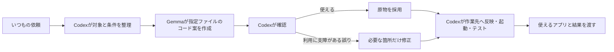

# 小さなアプリの作成に使う

Orchestrator LocalをONにして、Codexに「電卓アプリを作って」のように依頼します。コードを作る工程の一部をPC内のGemmaが担当し、結果の確認と仕上げはCodexが担当します。

初期の対象は、電卓のような小規模アプリや、ファイルと変更箇所を絞れるコード案です。既存プロジェクト全体の自動修正、依存関係の導入、デプロイをGemmaに任せる機能ではありません。必要な元コードはCodexが読み、依頼に関係する内容を渡します。直接処理した方がよい仕事はCodexが処理します。

元の要求を満たしていれば、そのコードを採用します。文体や好みの体裁だけで作り直しません。修正が必要な場合は、利用への影響がある箇所を差分で直し、前の版を残します。Gemmaへの自動再生成や別Cloud Reviewerは追加していません。

内部では`start_code_job`に元依頼・入力・相対ファイル名（最大12件）を渡します。返却は`data.files`の`path`と`content`です。候補を確認した後、`finalize_job`で採用し、結果フォルダの`source/`に保存します。アプリ自体が作業先を編集したり、コードを実行したりすることはありません。Codexが確認したファイルを作業先へ反映し、その会話で利用できる実行・テスト手段を使います。

MCPツールが表示されず、シェルが使える会話には、インストール済みSkillの補助スクリプトがあります。同じツール処理を呼ぶため、OFF時は新規生成しません。利用者がコマンドを入力する必要はありません。更新後はCodexを再起動し、新しい会話を開いてください。

この拡張によるコスト削減率はまだ測定していません。Localのtokensと時間は記録しますが、Codexの確認・テストを含む会話側Creditsは未計測です。業務データ100件の過去結果を、コード作成の節約率や品質保証には使いません。
